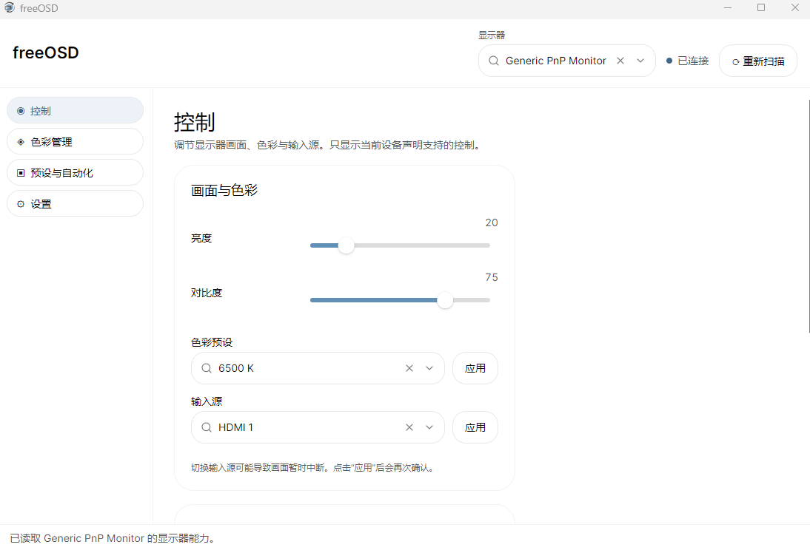

# freeOSD

[简体中文](README.zh-CN.md)

freeOSD is a desktop monitor-control application built with **C#, .NET 10, and Avalonia**. It uses DDC/CI to control monitor settings and provides Windows display-mode, color-management, and foreground-app automation features.

## Why freeOSD

freeOSD is being developed for people whose mid-range or entry-level monitors lack useful manufacturer control software, and for people who want different monitor settings applied quickly for different apps. For example, on a monitor that supports both 4K and 1080p, the intended experience is to switch to 1080p at a high refresh rate when an FPS game opens, then return to 4K at a lower refresh rate on the desktop. This is a project goal, not a current automatic feature: app rules can apply supported monitor presets, but they do not yet switch resolution or refresh rate. Those display modes can currently be changed manually.



## Features

- **Monitor controls:** Discover available monitors and show brightness, contrast, color-preset, and input-source controls according to each device's reported capabilities. Input-source changes require confirmation.
- **Windows display settings:** Query and change HDR, resolution, and refresh rate. Resolution and refresh rate are separate operations. A mode change starts a 15-second trial; keep the change to confirm it, or let the app attempt to restore the previous mode when the trial expires.
- **Profiles and automation:** Save and apply monitor presets. Switch presets based on the foreground application and choose a default preset for applications without a matching rule. Automatic application verifies each setting and skips input-source changes.
- **Color management:** Import, apply, and restore ICC/ICM profiles. SDR RGB calibration creates a separate ICC profile with VCGT data. SDR VCGT calibration is not applied while HDR is enabled.
- **Appearance and tray:** Chinese and English UI, system/light/dark themes, accent colors, Windows sign-in startup, and a system-tray icon.

DDC/CI requires a compatible monitor and connection path, and must be enabled in the monitor's on-screen menu. Monitor-control writes take effect immediately. Installing an ICC profile may require administrator privileges. Capabilities vary by monitor, GPU, driver, and connection type; some Windows hardware operations still need validation on target devices.

## Platform support

- **Windows:** The primary hardware backend currently provides DDC/CI, HDR, display modes, ICC/RGB color management, foreground-app monitoring, tray integration, and sign-in startup. Hardware combinations still require validation.
- **Linux:** The app uses a cross-platform UI and Core contracts, but the Linux DDC/CI backend and desktop integrations have not been implemented. Linux hardware support is not currently claimed.

## Download and use

The [Windows builds workflow](.github/workflows/windows-native-aot.yml) creates Windows x64 build artifacts. These are GitHub Actions artifacts, not long-term packages published on the GitHub Releases page, and are retained for 14 days. Download them from **Actions → Windows builds → a workflow run → Artifacts**.

| Artifact | Contents | Requirement to run |
|---|---|---|
| `freeOSD-win-x64-native-aot` | Self-contained Native AOT application; `.pdb` debug symbols are excluded | Windows x64; no separate .NET Runtime installation required |
| `freeOSD-win-x64-framework-dependent` | Framework-dependent publish output; `.pdb` debug symbols are excluded | Windows x64; a compatible .NET 10 Runtime must be installed |

Download and extract the artifact, then run `freeOSD.exe`. On first use, enable DDC/CI in the monitor's menu and rescan in freeOSD. Automatic preset switching is off by default and can be enabled on the **Profiles & Automation** page.

## Project structure

```text
.github/workflows/                     Windows x64 Native AOT and framework-dependent publishing
assets/                                 Application icons
docs/                                   Technical documentation, FAQ, and screenshots
src/MonitorControl.App/                 Avalonia UI, navigation, view models, and composition
src/MonitorControl.Core/                Cross-platform models, service contracts, and use cases
src/MonitorControl.Platform.Windows/    Windows DDC/CI, display settings, and system integrations
tests/MonitorControl.Core.Tests/        Hardware-independent Core checks
MonitorControl.sln                      .NET solution
```

The dependency direction is `App → Core ← Platform adapters`. Core does not depend on Avalonia or platform-specific APIs; platform features are provided through Core contracts. See [`UI-DESIGN.md`](UI-DESIGN.md), [`plan.md`](plan.md), and [`docs/core-contracts.md`](docs/core-contracts.md) for more details.

## Development and build

- .NET SDK 10.0.x; projects target `net10.0`.
- Local Windows Native AOT publishing requires a Windows C++ toolchain, such as the **Desktop development with C++** workload in Visual Studio 2022. GitHub Actions uses a Windows 2022 runner.

Run these commands in PowerShell from the repository root:

```powershell
$env:AVALONIA_TELEMETRY_OPTOUT = '1'
dotnet restore .\MonitorControl.sln
dotnet build .\MonitorControl.sln --no-restore -m:1 -v:minimal
dotnet run --project .\src\MonitorControl.App\MonitorControl.App.csproj
```

Run the hardware-independent Core checks:

```powershell
dotnet run --project .\tests\MonitorControl.Core.Tests\MonitorControl.Core.Tests.csproj
```

Publish Windows x64 builds locally:

```powershell
# Self-contained Native AOT; the target machine does not need a separate .NET Runtime
dotnet publish .\src\MonitorControl.App\MonitorControl.App.csproj -c Release -r win-x64 --self-contained true -p:PublishAot=true

# Framework-dependent; the target machine needs a compatible .NET 10 Runtime
dotnet publish .\src\MonitorControl.App\MonitorControl.App.csproj -c Release -r win-x64 --no-self-contained
```

## Planned work

- **Linux backend:** Implement monitor discovery and DDC/CI for Linux, then validate against named distributions, desktop environments, and X11/Wayland sessions. Evaluate tray, sign-in startup, refresh-rate, and HDR support separately.
- **OSD/VCP recognition and diagnostics:** Capture monitor OSD states and VCP snapshots, compare state changes, verify candidate mappings, and add report import/export with safe restoration.
- **Advanced color management:** Evaluate MHC2/HDR calibration, per-monitor profile lifecycles, and more complete brightness and white-point calibration.
- **Hardware validation and releases:** Expand validation across monitors, GPUs, and drivers. Formal GitHub Releases and installers may be added as release requirements evolve.

These items are not complete. See [`plan.md`](plan.md) for current implementation status and platform limitations.

## License

This project is licensed under the [MIT License](LICENSE), SPDX identifier `MIT`. MIT is an OSI-approved permissive open-source license. [License details](https://opensource.org/license/mit).

## Acknowledgements

Thanks to [Avalonia UI](https://github.com/AvaloniaUI/Avalonia) for the cross-platform .NET UI framework, and to [TKCode.Arc](https://github.com/AIDotNet/TKCode.Arc) for Avalonia controls and design tokens.
