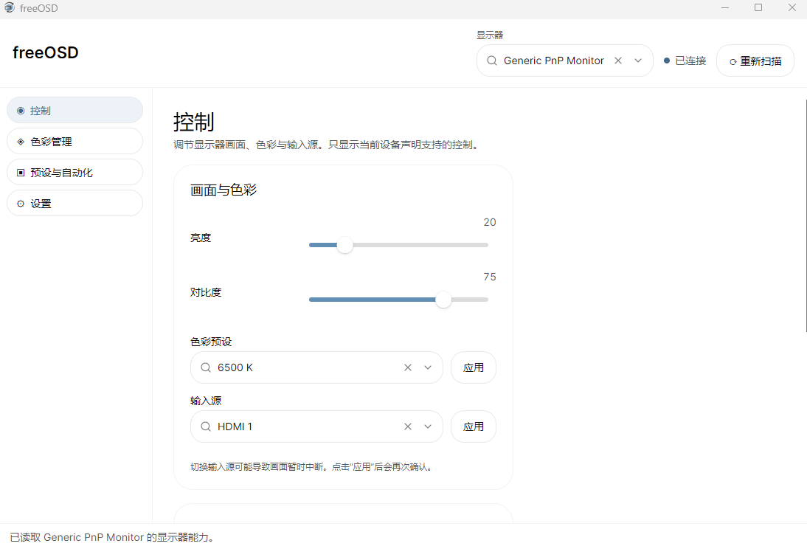

# freeOSD

[English](README.md)

freeOSD 是一个使用 **C#、.NET 10 和 Avalonia** 开发的桌面显示器控制软件。它通过 DDC/CI 调节显示器设置，并提供 Windows 显示模式、色彩管理和前台应用自动化功能。

## 开发初衷

freeOSD 面向两类需求：中低端显示器缺少实用的厂商控制软件；希望根据当前应用快速切换不同的显示器设置。在“预设与自动化”中保存应用对应的显示器方案。例如，一台同时支持 4K 和 1080p 的显示器，可以保存 1080p 高刷新率的 FPS 方案，以及 4K 低刷新率的桌面方案，再分别绑定应用。启用“自动应用预设中的分辨率和刷新率”后，前台应用切换时即可应用预设中的显示模式。此功能默认关闭；每次模式切换都有 15 秒自动回滚，并在读回目标模式后确认。



## 主要功能

- **显示器控制**：扫描可用显示器，并按设备报告的能力提供亮度、对比度、色彩预设和输入源控制。输入源切换会再次确认。
- **Windows 显示设置**：查询并设置 HDR、分辨率和刷新率。分辨率和刷新率采用独立操作；模式切换进入 15 秒试用，确认后保留，超时则尝试恢复。
- **预设与自动化**：保存和应用显示器预设（包含当前分辨率与刷新率）；可按前台程序切换预设，为未匹配规则的程序设置默认预设，并选择是否自动应用预设中的显示模式。自动切换显示模式有 15 秒回滚并验证读回结果；自动应用会跳过输入源。
- **色彩管理**：导入、应用及恢复 ICC/ICM 配置文件；提供 SDR RGB 校准，并通过 VCGT 生成独立的 ICC profile。HDR 开启时不应用 SDR VCGT 校准。
- **外观与托盘**：支持中文/英文、跟随系统/浅色/深色主题、强调色、Windows 登录启动和系统托盘。

DDC/CI 控制需要显示器和连接链路支持，并在显示器 OSD 中启用 DDC/CI。写入显示器控制值会立即生效。ICC profile 安装可能需要管理员权限。硬件能力会因显示器、显卡、驱动和连接方式而异；部分 Windows 硬件操作仍需在目标设备上验证。

## 支持平台

- **Windows**：当前主要硬件后端，提供 DDC/CI、HDR、显示模式、ICC/RGB 色彩管理、前台应用监控、托盘和登录启动；具体硬件组合仍需验证。
- **Linux**：应用采用跨平台 UI 和 Core 契约，但 Linux DDC/CI 及桌面集成功能尚未实现。当前不宣称 Linux 硬件功能可用。

## 下载与使用

[Windows builds 工作流](.github/workflows/windows-native-aot.yml)会生成 Windows x64 构建产物。它们是 Actions artifacts，不是 GitHub Releases 页面上的长期发行包；artifact 保留 14 天。进入仓库 **Actions → Windows builds → 对应运行记录 → Artifacts** 下载。

| artifact | 内容 | 运行要求 |
|---|---|---|
| `freeOSD-win-x64-native-aot` | Native AOT 自包含原生程序，不附带 `.pdb` 调试符号 | Windows x64；无需单独安装 .NET Runtime |
| `freeOSD-win-x64-framework-dependent` | 框架依赖发布文件，不附带 `.pdb` 调试符号 | Windows x64；需安装兼容的 .NET 10 Runtime |

下载并解压后运行 `freeOSD.exe`。首次使用时，先在显示器菜单中开启 DDC/CI，再回到 freeOSD 重新扫描显示器。自动切换预设默认关闭，可在“预设与自动化”页面启用。

## 项目结构

```text
.github/workflows/                     Windows x64 Native AOT 与框架依赖发布
assets/                                 应用图标
docs/                                   技术文档、FAQ 和界面截图
src/MonitorControl.App/                 Avalonia 界面、导航、ViewModel 和应用组合
src/MonitorControl.Core/                跨平台模型、服务契约和用例
src/MonitorControl.Platform.Windows/    Windows DDC/CI、显示设置和系统集成
tests/MonitorControl.Core.Tests/        Core 硬件无关检查
MonitorControl.sln                      .NET 解决方案
```

依赖方向为 `App → Core ← Platform adapters`。Core 不依赖 Avalonia 或平台专属 API；平台功能通过 Core 契约提供。更多设计见 [`UI-DESIGN.md`](UI-DESIGN.md)、[`plan.md`](plan.md) 和 [`docs/core-contracts.md`](docs/core-contracts.md)。

## 开发环境与编译

- .NET SDK 10.0.x；当前项目目标框架为 `net10.0`。
- Native AOT 本地发布需要 Windows C++ 编译工具链，例如 Visual Studio 2022 的 **Desktop development with C++** 工作负载。GitHub Actions 使用 Windows 2022 runner。

在仓库根目录使用 PowerShell：

```powershell
$env:AVALONIA_TELEMETRY_OPTOUT = '1'
dotnet restore .\MonitorControl.sln
dotnet build .\MonitorControl.sln --no-restore -m:1 -v:minimal
dotnet run --project .\src\MonitorControl.App\MonitorControl.App.csproj
```

运行硬件无关的 Core 检查：

```powershell
dotnet run --project .\tests\MonitorControl.Core.Tests\MonitorControl.Core.Tests.csproj
```

本地发布 Windows x64 版本：

```powershell
# 自包含 Native AOT；目标机器无需安装 .NET Runtime
dotnet publish .\src\MonitorControl.App\MonitorControl.App.csproj -c Release -r win-x64 --self-contained true -p:PublishAot=true

# 框架依赖版本；目标机器需安装兼容的 .NET 10 Runtime
dotnet publish .\src\MonitorControl.App\MonitorControl.App.csproj -c Release -r win-x64 --no-self-contained
```

## 后续计划

- **Linux 后端**：实现 Linux 显示器发现和 DDC/CI，并针对明确的发行版、桌面环境及 X11/Wayland 会话验证；再逐项评估托盘、登录启动、刷新率和 HDR。
- **OSD/VCP 识别与诊断**：采集显示器 OSD 状态和 VCP 快照、比较状态差异、验证候选映射，并提供报告导入/导出和安全恢复流程。
- **进阶色彩管理**：评估 MHC2/HDR 校准、多显示器独立 profile 生命周期，以及更完整的亮度和白点校准。
- **硬件验证与发布**：扩大显示器、GPU 和驱动组合的实机验证；后续可根据发布需求增加正式 GitHub Release 和安装包。

这些项目尚未完成。当前实施状态和平台限制以 [`plan.md`](plan.md) 为准。

## 许可

本项目采用 [MIT License](LICENSE)，SPDX 标识符为 `MIT`。MIT 是 OSI 批准的宽松开源许可证。[许可证说明](https://opensource.org/license/mit)

## 致谢

感谢 [Avalonia UI](https://github.com/AvaloniaUI/Avalonia) 提供跨平台 .NET UI 框架，并感谢 [TKCode.Arc](https://github.com/AIDotNet/TKCode.Arc) 提供 Avalonia 控件和设计 token。
